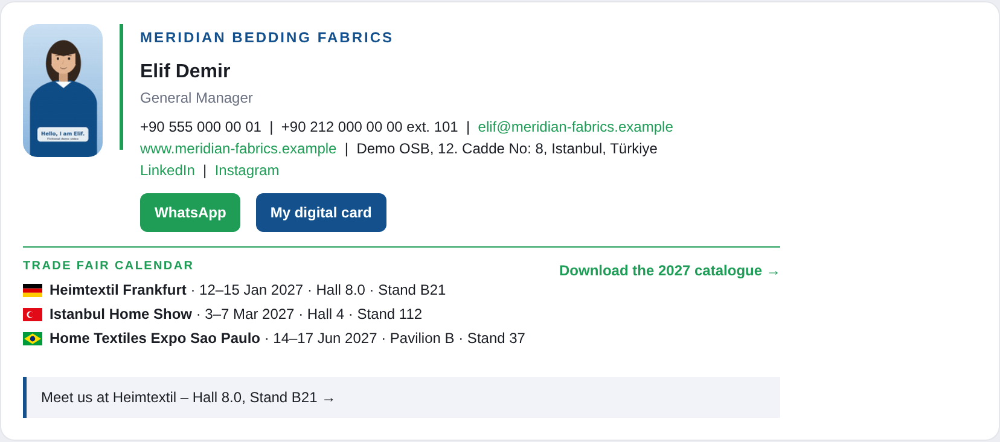
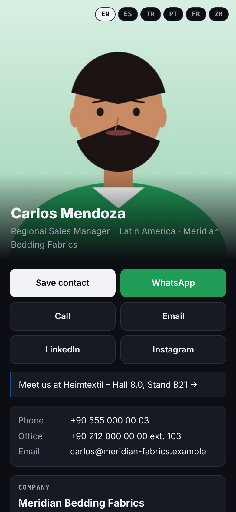
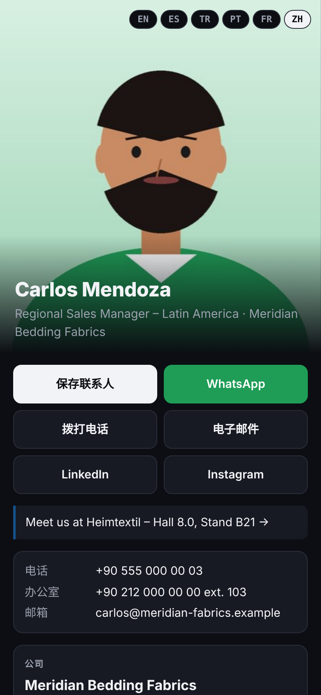
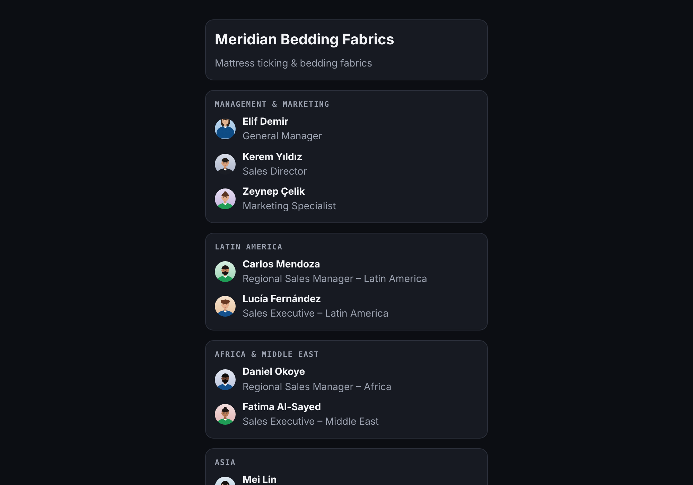
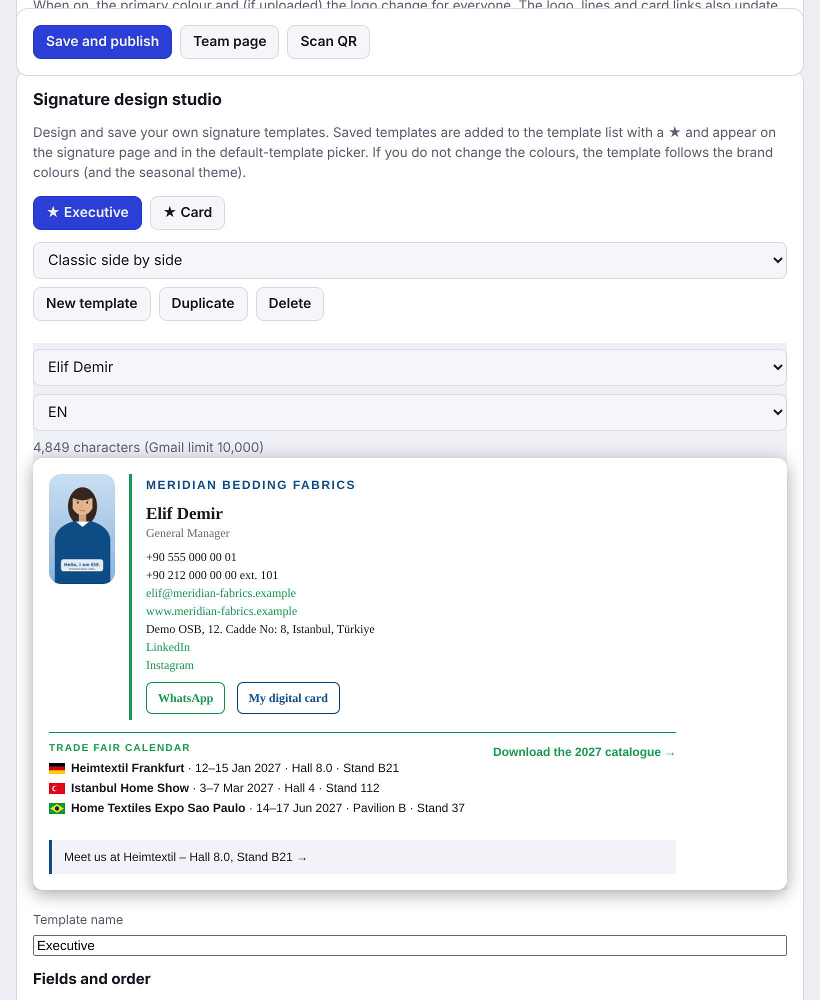

# Dynamic Signature

**Email signatures and digital business cards that stay up to date, on a single Cloudflare Worker.**
No build step, no dependencies, ~90 KB of code. Runs on the Cloudflare free tier (Workers + KV + D1).

English UI · cards and signatures in **6 languages** (EN, ES, TR, PT, FR, ZH) · MIT licensed · All demo data (company, people, phones, fairs, avatars, video) is fictional.

| Signature templates | Digital card (EN) | Digital card (ZH) | Team page |
|---|---|---|---|
|  |  |  |  |



## Why

An email signature is frozen text the moment it is pasted into Gmail or Outlook. Trade-fair dates, holiday notices, logos and colors go stale and nobody re-pastes 50 signatures.
This project keeps the *parts that can update* (hosted images, logo, colors, links) pointed at one place, so **you change a fair date once and every signature follows**, and it gives each person a **digital card** (vCard, WhatsApp, QR, video) that the signature links to.

## Features

### Digital business card (`/<name>`)
- Per-person mobile card: photo or **autoplay video** hero, one-tap **save to contacts (.vcf)**, call, e-mail, **WhatsApp** (pre-filled greeting), LinkedIn, Instagram
- Company section: address, hours, web, tagline
- **Searchable FAQ** (questions & answers shown on every card)
- **QR share**: a contact QR that works offline and a QR link to the card; built-in **QR scanner** page (`/scan`)
- **Org hierarchy** on the card, controlled per person: levels up and down (none / 1 / 2 / all)
- Team directory page (`/`) grouped by team
- **6 languages** (English, Spanish, Turkish, Portuguese, French, Chinese), chosen from the browser's `Accept-Language` or `?lang=`; a language switcher sits on every card

### Email signatures (`/<name>/signature`)
- **10 ready templates** (Classic, Compact, Top bar, Bottom bar, Vertical, Logo right, Minimal, Card, Bold name, Two columns) in 6 languages
- One-click **copy for Gmail / Outlook**, copy-as-HTML, and a **plain-text version for Gmail mobile**
- Step-by-step install guide per person (`/<name>/setup`)
- Gmail size counter (limit 10,000 characters)
- Signature buttons go through tracked redirects (`/go/<name>/wa|vcf|web|linkedin|instagram`)

### Signature design studio (admin)
- Design **your own templates**: photo left / right / top / none, size and corner radius, divider line, fonts (6 email-safe), sizes, colors, line spacing
- Reorder and toggle fields: logo, name & title, tagline, contact details (each of phone / office / e-mail / web / address / social on or off), buttons, free text
- Button style (filled / outline / link), optional framed card with background
- **Live preview** with any person and language, plus the Gmail character counter
- Save up to 30 templates (★ in the template list), duplicate, delete, set one as the company default
- Colors you do not override follow the brand palette and the seasonal theme

### Content blocks (appear under every signature)
- **Trade-fair calendar** with country flags
- **Holiday notice** with an optional start/end date window (shows and hides itself)
- Free text, **link button**, **image**, **GIF**, **PDF link**
- 1 or 2 columns, reorder with arrows, on/off per block
- **"Embed as image"** mode: fair/holiday/text blocks are rendered to an image hosted by the worker, so **Gmail and Outlook signatures that were pasted weeks ago pick up the change** (the image URL stays the same)

### Brand, season & banner
- Brand palette (up to 6 colors) with automatic roles (primary, accent, text, divider) chosen for contrast; override any role
- **Seasonal theme**: color and logo swap for a date range (e.g. New Year, Ramadan) across the whole team
- Company banner (a clickable strip under every signature)
- Logo, the bar/divider images of the built-in templates and card links update inside **already-sent** signatures

### Photos, video and GIF
- Fictional demo media is included (`assets/demo`: 9 illustrated avatars, an animated portrait video and a GIF) and loaded by `npm run seed`
- Browser-side image resize on upload
- Card **video** upload (up to 15 MB)
- **"Make GIF from video"** button: encodes a short animated GIF in the browser (custom LZW encoder, portrait crop, face-safe framing) for the e-mail signature photo; large GIFs are downscaled with `ImageDecoder`
- Cache-busting `?v=` URLs so Gmail picks up a new photo

### Admin panel (`/admin`)
- Single page, protected by one secret (`ADMIN_KEY`, header `x-admin-key`)
- Company, teams, people (add / remove, team assignment), boss relations, FAQ, blocks, studio, brand
- File pickers show the uploaded file name
- **Analytics**: views and button taps per person, source (signature / card / QR), country and day, last 30 days; bots are filtered out
- `robots.txt` blocks indexing

### Tech
- One ES module (`src/worker.mjs`), **Cloudflare Workers + KV (data and images) + D1 (analytics)**
- Server-rendered HTML with inline styles for e-mail clients, no framework
- Works without D1 (analytics is simply off)
- `npm test` smoke-tests the app locally (all 6 languages) with in-memory storage; `npm run preview` serves the demo, with media, on localhost
- `python3 tools/make-demo-media.py` regenerates the demo avatars, video and GIF (Pillow + ffmpeg)

## Quick start

```bash
git clone https://github.com/aipuerto/dynamic-signature && cd dynamic-signature
npm install
npx wrangler kv namespace create KV           # put the id in wrangler.toml
npx wrangler d1 create dynamic-signature      # put the id in wrangler.toml
npm run db:init                               # analytics table
npx wrangler secret put ADMIN_KEY             # your admin password
npm run deploy
```

Open `https://<your-worker>.workers.dev/admin`, enter the key, edit the demo company, press **Save and publish**.
A fresh deployment already shows the fictional demo company (Meridian Bedding Fabrics). To also load the demo logo, avatars, video and GIF:

```bash
BASE_URL=https://<your-worker>.workers.dev ADMIN_KEY=... npm run seed
```

**Try it without Cloudflare:** `npm run preview`, then open <http://localhost:8787/admin> (key: `demo`). Data lives in memory.

## How updating works (read this)

| Part of the signature | After you change it |
|---|---|
| Logo, bar/divider images of built-in templates, button/card links, hosted images, "embed as image" blocks | Updates in signatures already sent, no re-paste |
| Name, title, phone, e-mail, address, text, and the colors and divider lines of studio templates | Frozen at paste time, copy the signature again |
| Photo | Same URL is cached by Gmail; the `?v=` URL changes, so **re-copy once** after a photo change |

Honest limits:
- **Outlook desktop shows only the first frame of a GIF.** Gmail, Apple Mail, Outlook web/mobile animate it.
- Gmail mobile cannot use image signatures; use the plain-text version.
- Some clients block remote images until the reader allows them.
- The admin UI is in English; cards, signatures and content blocks support EN / ES / TR / PT / FR / ZH. Text you type (names, FAQ, fairs) is shown as written in every language.
- Single company per deployment. Multi-tenant (one subdomain per company) is on the roadmap.

## Roadmap
- Multi-tenant mode (subdomain per company, per-company admin key)
- Assign templates per team or person
- Push signatures automatically (Google Workspace API, Outlook add-in)
- Translate the admin UI (it is English only today)

## Data & privacy
Everything is stored in your own Cloudflare account. Card pages are public by design (they are business cards); the admin API and image uploads require the admin key. Do not put anything secret in the data.

## License
MIT
