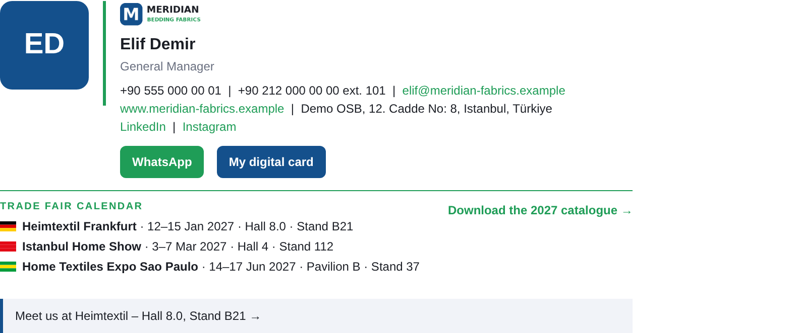
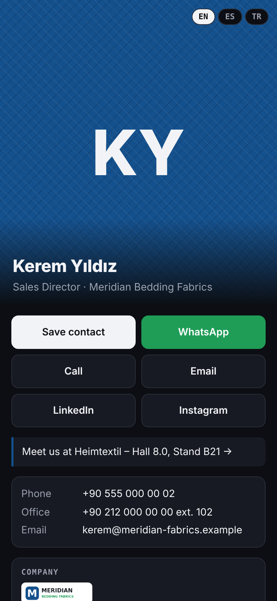
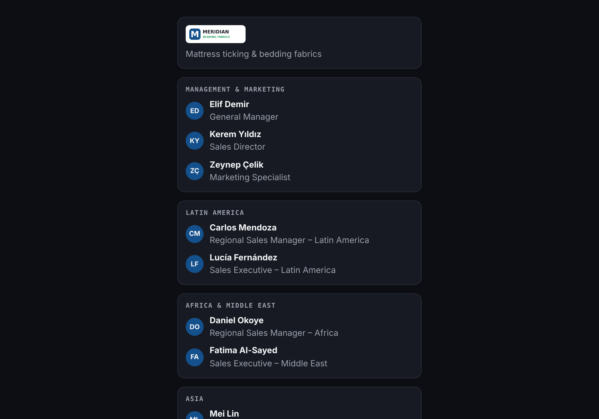
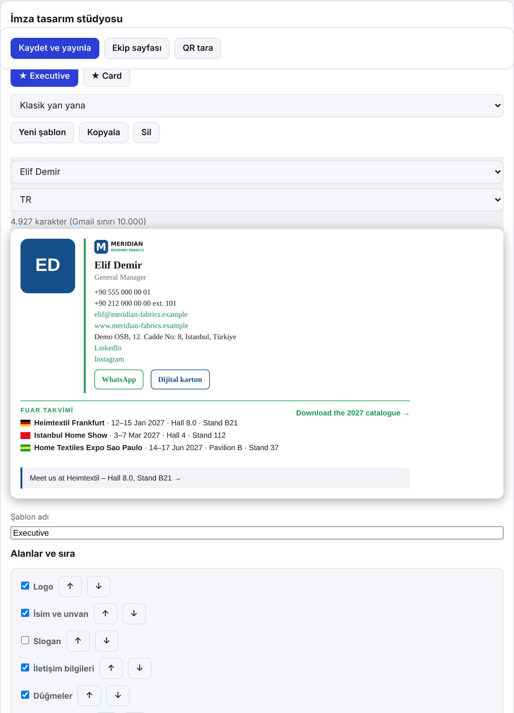

# Dinamik İmza

**Güncel kalan e-posta imzaları ve dijital kartvizitler. Tek bir Cloudflare Worker üzerinde çalışır.**
Derleme adımı yok, bağımlılık yok, ~90 KB kod. Cloudflare ücretsiz katmanında (Workers + KV + D1) çalışır.

[English](README.md) · MIT lisanslı · Demo verilerin hepsi (firma, kişiler, telefonlar, fuarlar) kurgusaldır.

| İmza şablonları | Dijital kart | Ekip sayfası |
|---|---|---|
|  |  |  |



## Neden

E-posta imzası, Gmail'e ya da Outlook'a yapıştırıldığı anda donmuş metindir. Fuar tarihleri, tatil duyuruları, logo ve renkler eskir; kimse 50 kişinin imzasını yeniden yapıştırmaz.
Bu proje, güncellenebilen parçaları (barındırılan görseller, logo, renkler, bağlantılar) tek bir yere bağlar. **Fuar tarihini bir kez değiştirirsin, herkesin imzası takip eder.** Her kişiye de imzanın bağlandığı bir **dijital kart** verir (vCard, WhatsApp, QR, video).

## Özellikler

### Dijital kartvizit (`/<isim>`)
- Kişiye özel mobil kart: fotoğraf ya da **otomatik oynayan video**, tek dokunuşla **rehbere ekle (.vcf)**, ara, e-posta, **WhatsApp** (hazır selamlama metniyle), LinkedIn, Instagram
- Firma bölümü: adres, çalışma saatleri, web, slogan
- **Aranabilir sık sorulan sorular** bölümü
- **QR ile paylaşım**: internetsiz çalışan rehber QR'ı ve kart bağlantısı QR'ı; **QR tarayıcı** sayfası (`/scan`)
- Kartta **organizasyon hiyerarşisi**, kişi bazında kontrol: yukarı ve aşağı seviye (hiç / 1 / 2 / tümü)
- Ekibe göre gruplanmış ekip sayfası (`/`)
- 3 dil (EN / ES / TR), tarayıcıdan ya da `?lang=` ile

### E-posta imzası (`/<isim>/imza`)
- 3 dilde **10 hazır şablon** (Klasik, Kompakt, Üst şerit, Alt şerit, Dikey, Logo sağda, Minimal, Kart, Kalın isim, İki sütun)
- Tek tıkla **Gmail / Outlook için kopyala**, HTML olarak kopyala ve **Gmail mobil için düz metin** sürümü
- Kişiye özel adım adım kurulum sayfası (`/<isim>/kurulum`)
- Gmail boyut sayacı (sınır 10.000 karakter)
- İmzadaki düğmeler izlenen yönlendirmelerden geçer (`/go/<isim>/wa|vcf|web|linkedin|instagram`)

### İmza tasarım stüdyosu (yönetim paneli)
- **Kendi şablonunu tasarla**: fotoğraf solda / sağda / üstte / yok, boyut ve köşe yuvarlaklığı, ayraç çizgisi, 6 e-postaya uygun yazı tipi, boyutlar, renkler, satır aralığı
- Alanları sırala ve aç/kapat: logo, isim ve unvan, slogan, iletişim bilgileri (telefon / ofis / e-posta / web / adres / sosyal tek tek), düğmeler, serbest metin
- Düğme stili (dolgulu / çerçeveli / bağlantı), isteğe bağlı çerçeveli ve arka planlı kart
- Seçtiğin kişi ve dille **canlı önizleme**, Gmail karakter sayacıyla birlikte
- 30 şablona kadar kaydet (şablon listesinde ★), kopyala, sil, firma varsayılanı yap
- Elle değiştirmediğin renkler marka paletini ve sezon temasını izler

### İçerik blokları (her imzanın altında)
- **Fuar takvimi**, ülke bayraklarıyla
- Başlangıç/bitiş tarihli **tatil bilgisi** (kendiliğinden görünür ve gizlenir)
- Serbest metin, **bağlantı düğmesi**, **resim**, **GIF**, **PDF bağlantısı**
- 1 ya da 2 sütun, okla sıralama, blok başına aç/kapat
- **"Görsel olarak göm"** modu: fuar/tatil/metin blokları worker'da görsele çevrilir. Haftalar önce yapıştırılmış **Gmail ve Outlook imzaları değişikliği otomatik alır** (görsel adresi aynı kalır)

### Marka, sezon ve banner
- En çok 6 renkli marka paleti; ana, vurgu, metin ve ayraç rolleri kontrasta göre otomatik seçilir, istersen elle değiştirirsin
- **Sezon teması**: tarih aralığında renk ve logo tüm ekipte değişir (yılbaşı, Ramazan vb.)
- Firma banner'ı (her imzanın altında tıklanabilir şerit)
- Logo, hazır şablonların şerit/ayraç görselleri ve kart bağlantıları **önceden gönderilmiş** imzalarda da güncellenir

### Fotoğraf, video ve GIF
- Yüklemede tarayıcıda küçültme
- Kart **videosu** yükleme (15 MB'a kadar)
- **"Videodan GIF yap"** düğmesi: imza fotoğrafı için kısa animasyonlu GIF'i tarayıcıda üretir (kendi LZW kodlayıcısı, dikey kırpma, yüzü kesmeyen çerçeve). Büyük GIF'ler `ImageDecoder` ile küçültülür
- Gmail'in yeni fotoğrafı alması için `?v=` ile önbellek kırma

### Yönetim paneli (`/admin`)
- Tek sayfa, tek sırla korunur (`ADMIN_KEY`, `x-admin-key` başlığı)
- Firma, ekipler, kişiler (ekle / sil, ekip atama), bağlı olduğu yönetici, SSS, bloklar, stüdyo, marka
- Dosya seçicileri yüklü dosyanın adını gösterir
- **İstatistik**: kişi bazında görüntüleme ve düğme tıklamaları; kaynak (imza / kart / QR), ülke ve gün; son 30 gün; botlar elenir
- `robots.txt` indekslemeyi engeller

### Teknik
- Tek ES modülü (`src/worker.mjs`), **Cloudflare Workers + KV (veri ve görseller) + D1 (istatistik)**
- E-posta istemcileri için satır içi stilli, sunucuda üretilen HTML; framework yok
- D1 olmadan da çalışır (istatistik kapalı kalır)
- `npm test` uygulamayı bellek içi depolamayla yerelde sınar; `npm run preview` localhost'ta çalıştırır

## Hızlı kurulum

```bash
git clone https://github.com/aipuerto/dynamic-signature && cd dynamic-signature
npm install
npx wrangler kv namespace create KV           # id'yi wrangler.toml'a yaz
npx wrangler d1 create dynamic-signature      # id'yi wrangler.toml'a yaz
npm run db:init                               # istatistik tablosu
npx wrangler secret put ADMIN_KEY             # yönetim şifren
npm run deploy
```

`https://<worker-adın>.workers.dev/admin` adresini aç, anahtarı gir, demo firmayı düzenle ve **Kaydet ve yayınla**'ya bas.
Yeni kurulumda kurgusal demo firma (Meridian Bedding Fabrics) hazır gelir. Demo logoyu da yüklemek için:

```bash
BASE_URL=https://<worker-adın>.workers.dev ADMIN_KEY=... npm run seed
```

**Cloudflare olmadan dene:** `npm run preview`, sonra <http://localhost:8787/admin> (anahtar: `demo`). Veri bellekte durur.

## Güncelleme nasıl çalışır (önemli)

| İmzanın parçası | Değiştirince |
|---|---|
| Logo, hazır şablonların şerit/ayraç görselleri, düğme/kart bağlantıları, barındırılan görseller, "görsel olarak göm" blokları | Gönderilmiş imzalarda yeniden yapıştırmadan güncellenir |
| İsim, unvan, telefon, e-posta, adres, metin ve stüdyo şablonlarının renkleri ile ayraç çizgileri | Yapıştırıldığı anda donar, imzayı yeniden kopyala |
| Fotoğraf | Gmail aynı adresi önbelleğe alır; `?v=` adresi değişir, fotoğraf değişince **bir kez yeniden kopyala** |

Dürüst sınırlar:
- **Outlook masaüstü GIF'in yalnızca ilk karesini gösterir.** Gmail, Apple Mail, Outlook web/mobil oynatır.
- Gmail mobil görselli imzayı desteklemez; düz metin sürümünü kullan.
- Bazı istemciler okuyucu izin verene kadar uzaktaki görselleri engeller.
- Yönetim paneli Türkçe; kartlar ve imzalar EN / ES / TR destekler.
- Kurulum başına tek firma. Çok kiracılı mod (firma başına alt alan adı) yol haritasında.

## Yol haritası
- Çok kiracılı mod (firma başına alt alan adı ve yönetici anahtarı)
- Şablonu ekip ya da kişi bazında atama
- İmzayı otomatik gönderme (Google Workspace API, Outlook eklentisi)
- Çevrilmiş yönetim paneli

## Veri ve gizlilik
Her şey kendi Cloudflare hesabında durur. Kart sayfaları tasarım gereği herkese açıktır (kartvizittir); yönetim API'si ve görsel yükleme yönetici anahtarı ister. Veriye gizli bir şey koyma.

## Lisans
MIT
